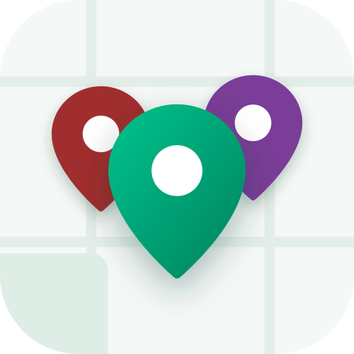
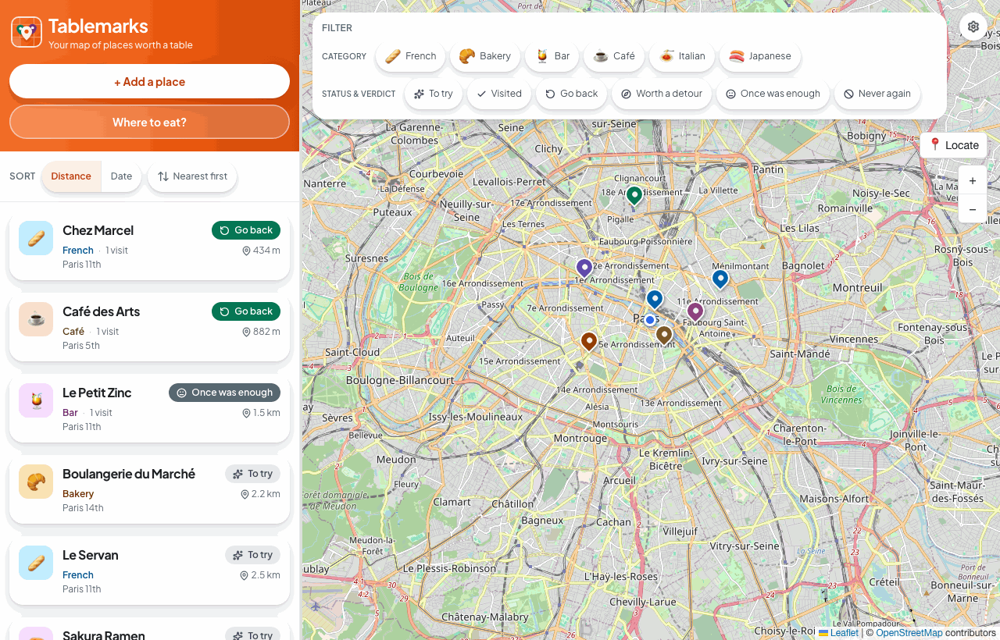

<p align="center">
  
</p>

# Tablemarks <!-- omit from toc -->

<p align="center">
  <a href="https://baptiste-pasquier.github.io/tablemarks/">
    
  </a>
</p>

<p align="center">
  
</p>

Tablemarks is a React 19 app for saving the restaurants you love and the ones you want to try,
on a map. It is **local-first**: it works fully in your browser with no account, and signing in
with Google backs up and syncs your places across devices through PocketBase.

- [Try it](#try-it)
- [Features](#features)
- [Architecture](#architecture)
- [Technologies](#technologies)
- [Documentation](#documentation)
- [Quick Start](#quick-start)
  - [Docker](#docker)
  - [Local Development](#local-development)

## Try it

**[Live demo →](https://baptiste-pasquier.github.io/tablemarks/)**

The demo runs with no backend, so there is no sign-in and no sync — and short `maps.app.goo.gl` links, which need a server to resolve, are refused. Search by name or paste a full Google Maps link instead. Everything else works, and your data stays in your browser.

## Features

- 🔗 **Add by Link or Name**: Paste a Google Maps link or search a name, and check the
  OpenStreetMap preview before the place is saved
- 🕒 **Place Details**: Area, open now, weekly hours, and Call / Website buttons from
  OpenStreetMap -- _Complete_, _Refresh_ and _Correct_ keep them current
- ✅ **Visits & Verdicts**: Log a visit with _I'm here now_ or a past date, and a returnability
  verdict -- _Go back · Worth a detour · Once was enough · Never again_
- 🗺️ **Map & List**: Every place on a map beside the list, sorted by distance or by date
- 🏷️ **Filters**: Narrow the list and the map by category (cuisine, bakery, bar…), status and
  verdict
- 🎲 **Where to Eat?**: Pick a place to try, or one worth going back to, near the map's center
- 🔐 **Authentication**: Optional Google sign-in -- no account is needed to start
- ☁️ **Cloud Sync**: Signed-in devices sync through PocketBase; signing out erases this device's data, after sending what is pending
- 🔌 **Offline Support**: An installable PWA whose data lives in IndexedDB, with the map tiles
  you have viewed cached for offline use
- 💾 **Import/Export**: Back up places and visits together in one versioned JSON file
- 🌍 **Two Languages**: English and French
- 🐳 **Docker Deployment**: A private two-container stack, and a backend-free public demo on
  GitHub Pages

## Architecture

Tablemarks is a client-only Single Page Application with an optional Backend-as-a-Service.

- **Frontend**: A React 19 application in three layers, one direction: features call the
  repository (`src/data/`), which owns IndexedDB, and the sync engine (`src/sync/`) is the only
  code that talks to PocketBase. Features never reach either store directly, which is why the
  app behaves the same with or without an account.
- **Local-first storage**: IndexedDB is the canonical store, and doubles as the durable sync
  outbox: a write made offline survives a reload and is sent on the next connection.
- **Backend (optional)**: PocketBase provides:
  - **Database**: SQLite storage for places, visits and users, every collection scoped to its
    owner.
  - **Authentication**: Google OAuth2 sign-in.
  - **API**: REST and realtime sync, reconciled per record by last write wins, and a hook that
    resolves short `maps.app.goo.gl` links.
- **Runtime configuration**: The backend address is read at startup from a served
  `config.json`, so one build serves both the private stack and the demo, which has no backend.
- **Offline Capability**: The app shell is precached and viewed map tiles are cached; all data
  stays usable offline, and a new version asks before reloading.
- **Deployment**: The private stack runs the app behind Nginx and PocketBase in a separate
  container; the demo is the same build on GitHub Pages.

## Technologies

| Category          | Stack                                                                                                                                                                                  |
| :---------------- | :------------------------------------------------------------------------------------------------------------------------------------------------------------------------------------- |
| **Core Frontend** | [React 19](https://react.dev/), [TypeScript](https://www.typescriptlang.org/), [Vite v7](https://vite.dev/), [vite-plugin-pwa](https://vite-pwa-org.netlify.app/)                      |
| **Data & i18n**   | [idb](https://github.com/jakearchibald/idb) (IndexedDB), [i18next](https://www.i18next.com/)                                                                                           |
| **Map**           | [Leaflet](https://leafletjs.com/), [React Leaflet](https://react-leaflet.js.org/), [OpenStreetMap](https://www.openstreetmap.org/) (tiles and Nominatim)                               |
| **UI & Styling**  | [Tailwind CSS v4](https://tailwindcss.com/), [Lucide React](https://lucide.dev/)                                                                                                       |
| **Backend & Ops** | [PocketBase](https://pocketbase.io/), [Docker](https://www.docker.com/), [Nginx](https://nginx.org/)                                                                                   |
| **Testing & QA**  | [Vitest](https://vitest.dev/), [Testing Library](https://testing-library.com/), [Playwright](https://playwright.dev/), [ESLint](https://eslint.org/), [Prettier](https://prettier.io/) |

## Documentation

Start at **[docs/README.md](./docs/README.md)** for the full map and the rule for where a
new doc belongs.

- **[Development Guide](./docs/how-to/development.md)** - Setup, project structure, scripts,
  testing, and the optional PocketBase backend
- **[Architecture Notes](./docs/explanation/architecture.md)** - The local-first design, sync,
  and offline behavior
- **[Data Model](./docs/reference/data-model.md)** - Record shapes, verdicts, the rollup, and
  local↔remote mapping
- **[Design Tokens](./docs/reference/design-tokens.md)** - The color, shape and cuisine-palette
  contract
- **[Demo Preview](./docs/how-to/demo-preview.md)** - README demo GIF details and regeneration
  workflow
- **[Deployment](./docs/how-to/deployment.md)** - The two deployment targets, the PocketBase
  console sequence, upgrades, rollback and recovery
- **[PocketBase Backend](./pocketbase/README.md)** - Collections, Google OAuth, and the
  short-link resolver

## Quick Start

### Docker

```bash
git clone https://github.com/baptiste-pasquier/tablemarks.git
cd tablemarks
cp docker/.env.example docker/.env
docker compose -f docker/docker-compose.yml up -d --build
```

Access the app at `http://localhost:8080` and PocketBase at `http://localhost:8090/_/`.

### Local Development

With Node.js 24 (the version in `.nvmrc`):

```bash
npm install
npm run dev
```

This starts the app with no backend, the same as the demo: you can add places right away. See
[Development Guide](./docs/how-to/development.md) for the full workflow and
[PocketBase Backend](./pocketbase/README.md) for Google sign-in and sync.
